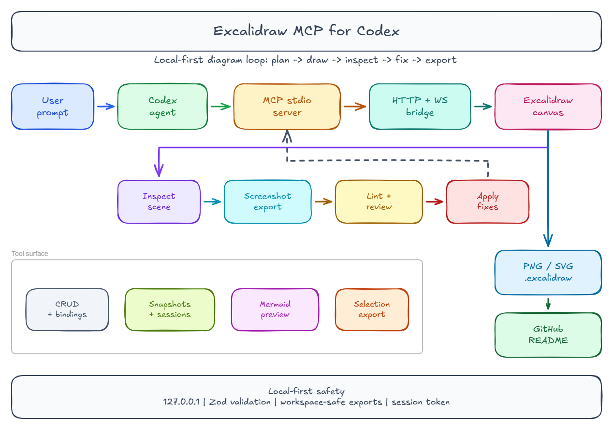
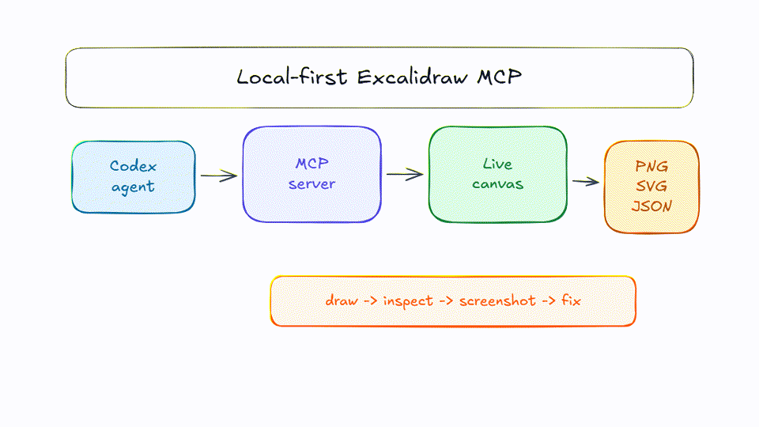

# Excalidraw MCP for Codex

Local-first Model Context Protocol server for building, inspecting, editing, verifying, and exporting Excalidraw diagrams from Codex.

<p align="center">
  
  <br>
  
</p>

The project is designed as a canvas toolkit, not a one-shot prompt-to-diagram generator. The intended loop is:

```text
draw -> inspect scene -> screenshot/export -> fix layout -> export
```

For larger changes, treat the work as a small production pass:

```text
plan -> draw/import -> lint visually -> fix -> review screenshot -> export
```

## What It Provides

- A stdio MCP server Codex can register with `codex mcp add`.
- A local Excalidraw browser canvas powered by `@excalidraw/excalidraw`.
- A local HTTP/WebSocket bridge so MCP tool calls update the canvas in real time.
- A Codex skill at `.agents/skills/excalidraw-codex` that teaches agents the drawing and verification workflow.
- Tests for schemas, state, MCP tools, canvas bridge behavior, import/export, and browser smoke checks.

## Installation Options

Use one of three distribution lanes, depending on who is installing it.

### npx package for MCP clients

After the package is published to npm, this is the recommended install path for Codex, Claude Code, OpenClaw, Antigravity, and other clients that can launch stdio MCP servers.

Codex:

```powershell
codex mcp add excalidraw -- npx -y excalidraw-mcp-for-codex@latest
```

Claude Code:

```powershell
claude mcp add --scope user --transport stdio excalidraw -- npx -y excalidraw-mcp-for-codex@latest
```

Generic MCP client JSON:

```json
{
  "mcpServers": {
    "excalidraw": {
      "command": "npx",
      "args": ["-y", "excalidraw-mcp-for-codex@latest"]
    }
  }
}
```

Codex TOML equivalent:

```toml
[mcp_servers.excalidraw]
command = "npx"
args = ["-y", "excalidraw-mcp-for-codex@latest"]
startup_timeout_sec = 20
tool_timeout_sec = 120
default_tools_approval_mode = "auto"

[mcp_servers.excalidraw.tools.clear_canvas]
approval_mode = "prompt"

[mcp_servers.excalidraw.tools.delete_elements]
approval_mode = "prompt"

[mcp_servers.excalidraw.tools.import_scene]
approval_mode = "prompt"
```

### GitHub source install

Use this path if you want to clone the repo, inspect the code, or develop new tools.

```powershell
git clone <repo-url>
cd excalidraw-mcp-for-codex
npm ci
npm run build
codex mcp add excalidraw -- node C:\absolute\path\to\excalidraw-mcp-for-codex\dist\server\mcp\index.js
```

For non-Codex clients, point the client at the same built entrypoint:

```json
{
  "mcpServers": {
    "excalidraw": {
      "command": "node",
      "args": ["C:\\absolute\\path\\to\\excalidraw-mcp-for-codex\\dist\\server\\mcp\\index.js"]
    }
  }
}
```

### Local auto-publish on push

This project intentionally does not use GitHub Actions or any CI/CD workflow. To publish when you push, enable the committed local Git hook:

```powershell
npm run setup:publish-hooks
```

The hook runs before `git push` completes. It publishes to npm only when pushing `main` or `master`, and it skips publishing when the current `package.json` version already exists on npm. To publish a new release, bump `package.json` first, commit, and push.

The hook does not store npm tokens. Use your normal npm login, 2FA flow, or a local npm token in your own shell. To skip the hook for one push:

```powershell
$env:SKIP_NPM_PUBLISH_ON_PUSH = "1"
git push
Remove-Item Env:SKIP_NPM_PUBLISH_ON_PUSH
```

### Codex plugin bundle

Use this path when Codex users should receive both the MCP server and the bundled diagram skill.

- `.codex-plugin/plugin.json` describes the plugin metadata, screenshots, skills, and MCP server reference.
- `.mcp.json` points Codex at the local built stdio server.
- `.agents/skills/excalidraw-codex` teaches Codex the inspect, screenshot, fix, and export workflow.

Build before packaging or importing the plugin bundle:

```powershell
npm ci
npm run build
```

Then distribute the repository or release archive with `.codex-plugin`, `.mcp.json`, `.agents/skills`, `dist`, `README.md`, and the example assets included.

## Install

```powershell
npm ci
```

## Build

```powershell
npm run build
```

Useful development commands:

```powershell
npm run typecheck
npm test
npm run test:e2e
npm run examples:generate
npm run bench:scenes
npm run dev:web
```

For a one-command local setup pass that builds, writes a project Codex MCP config, runs the skill healthcheck, and verifies MCP tool listing:

```powershell
npm run setup:codex
```

## Run

After building, run the MCP server with Node:

```powershell
node .\dist\server\mcp\index.js
```

The MCP server starts over stdio. Use `start_canvas` from Codex to start or verify the local browser canvas. The canvas server binds to `127.0.0.1` by default.

## Codex MCP Registration

From this repository, build first:

```powershell
npm ci
npm run build
```

Then register the server with an absolute Windows path:

```powershell
codex mcp add excalidraw -- node C:\Users\Raghvendra\Desktop\coding-and-dev\excalidraw-mcp-for-codex\dist\server\mcp\index.js
```

If your checkout lives somewhere else, replace the path with your own absolute `dist\server\mcp\index.js` path.

## Codex Plugin Package

This repo also includes a local plugin manifest:

- `.codex-plugin/plugin.json` describes the plugin, skill, MCP server, and screenshots.
- `.mcp.json` points Codex at `./dist/server/mcp/index.js` after `npm run build`.
- `.agents/skills/excalidraw-codex` teaches agents the diagram workflow.

Build before using the plugin package so the referenced `dist` server exists.

## Project-Scoped Codex Config

Example project-scoped configuration:

```toml
[mcp_servers.excalidraw]
command = "node"
args = ["C:\\Users\\Raghvendra\\Desktop\\coding-and-dev\\excalidraw-mcp-for-codex\\dist\\server\\mcp\\index.js"]
startup_timeout_sec = 20
tool_timeout_sec = 120
default_tools_approval_mode = "auto"

[mcp_servers.excalidraw.tools.clear_canvas]
approval_mode = "prompt"

[mcp_servers.excalidraw.tools.delete_elements]
approval_mode = "prompt"

[mcp_servers.excalidraw.tools.import_scene]
approval_mode = "prompt"
```

Use an absolute path for `args`. On Windows, escape backslashes in TOML strings.

## Tools

The MCP server exposes a full canvas toolkit rather than a single generator:

| Area | Tools |
| --- | --- |
| Canvas | `start_canvas`, `read_diagram_guide`, `set_viewport`, `get_canvas_screenshot` |
| Element CRUD | `batch_create_elements`, `update_elements`, `delete_elements`, `clear_canvas`, `query_elements`, `describe_scene` |
| Quality | `lint_scene`, `suggest_layout_fixes`, `apply_layout_fixes`, `route_arrows`, `auto_layout`, `polish_scene`, `diagram_review_report` |
| Sources | `create_verified_diagram`, `create_diagram_plan`, `create_from_template`, `create_from_mermaid`, `preview_mermaid_conversion`, `normalize_mermaid_layout`, `create_repo_diagram`, `create_github_readme_assets` |
| Imports | `import_openapi`, `import_package_dependencies`, `import_database_schema`, `import_markdown_outline`, `import_plantuml`, `import_structurizr` |
| Styling and semantics | `theme_scene`, `tag_elements`, `set_element_order`, `add_image`, `group_elements`, `ungroup_elements`, `create_frame_from_elements`, `duplicate_elements` |
| Export and history | `export_scene`, `import_scene`, `export_to_image`, `export_selection_to_image`, `snapshot_scene`, `restore_snapshot`, `compare_snapshots`, `diff_scenes` |
| Sessions | `session_status`, `save_session`, `load_session`, `list_canvas_sessions`, `save_canvas_session`, `switch_canvas_session`, `delete_canvas_session` |

Workflow additions emphasize:

- Managed headless export: screenshot and image export tools can start a headless canvas client when no browser is already connected.
- Safer local auth: the canvas URL carries the bootstrap token in the hash fragment, and API reads use the `x-excalidraw-mcp-token` header.
- Dagre auto-layout and routing: use `auto_layout`, `route_arrows`, or `polish_scene` when diagrams become crowded or layered.
- Template, repo, and source imports: start from built-in diagram templates, Mermaid, workspace scans, OpenAPI specs, package graphs, SQL schemas, Markdown outlines, PlantUML, or Structurizr DSL, then inspect and refine.
- Verified diagram workflow: use `create_verified_diagram` for a high-level plan/import -> layout -> screenshot -> lint -> polish -> export pass.
- Multi-session work: save named sessions when working on multiple diagrams in one repository.

## Example Gallery

Generate the gallery after building:

```powershell
npm run build
npm run examples:generate
```

The script writes PNG, SVG, and `.excalidraw` files under `examples/`, a golden manifest for visual regression, and a short demo GIF at `docs/assets/excalidraw-mcp-demo.gif` when `ffmpeg` is available.

## Performance Benchmark

Run the large-scene benchmark:

```powershell
npm run build
npm run bench:scenes
```

It measures 100, 500, 1,000, and 5,000 element scenes for create time, Dagre layout time, patch time, scene export time, JSON size, and heap usage. Results are written to `benchmarks/performance-benchmark.json` and `.md`.

## Security Notes

- Canvas HTTP and WebSocket calls require a random local session token.
- Canvas URLs keep the token in the hash fragment for browser bootstrap; API reads use `x-excalidraw-mcp-token`.
- Import/export paths are restricted to the workspace by default.
- Image imports reject oversized files and SVG active content such as scripts, event handlers, `javascript:` URLs, and `foreignObject`.
- Tool descriptions mark destructive operations so Codex can request approval for risky changes.

## Element Input

Tools accept simplified Excalidraw skeleton JSON at the MCP boundary. Supported element types are:

```text
rectangle, ellipse, diamond, text, arrow, line, frame, image
```

Elements also support optional `angle`, `zIndex`, `metadata`, `locked`, `fileId`, and image file data through `add_image`. Use `metadata` for semantic roles such as `service`, `database`, `trust-boundary`, `owner`, or `documentation-output`.

Example:

```json
{
  "elements": [
    {
      "id": "start",
      "type": "rectangle",
      "x": 80,
      "y": 120,
      "width": 180,
      "height": 80,
      "label": { "text": "Start", "fontSize": 20 },
      "backgroundColor": "#e7f5ff",
      "strokeColor": "#1971c2"
    },
    {
      "id": "done",
      "type": "rectangle",
      "x": 360,
      "y": 120,
      "width": 180,
      "height": 80,
      "label": { "text": "Done", "fontSize": 20 },
      "backgroundColor": "#ebfbee",
      "strokeColor": "#2b8a3e"
    },
    {
      "id": "start-to-done",
      "type": "arrow",
      "startElementId": "start",
      "endElementId": "done",
      "label": { "text": "next" }
    }
  ]
}
```

Use stable custom IDs when you expect later edits. Omitted IDs are generated automatically.

## Agent Workflow

Recommended Codex workflow:

1. Call `start_canvas`.
2. Call `read_diagram_guide`.
3. Inspect the current scene with `describe_scene` or `query_elements` before editing.
4. Plan the coordinate grid and stable IDs.
5. Use `batch_create_elements` for initial creation.
6. Use `auto_layout` with Dagre or `polish_scene` for graph-like diagrams.
7. Use `set_viewport` to fit or center the diagram.
8. Call `get_canvas_screenshot`.
9. Fix visible issues such as clipped text, overlap, awkward spacing, or arrows through unrelated elements.
10. Export with `export_scene` or `export_to_image` when requested.

Prefer updating existing IDs over deleting and recreating elements. Use snapshots before risky edits.

### Sub-Agent Workflow

When multiple agents work in this repository, split ownership before editing:

- MCP/core workers own tool behavior, schemas, and runtime contracts.
- Canvas workers own browser rendering, viewport behavior, and screenshot/export plumbing.
- Docs/skill workers own README, skill instructions, cheatsheets, and visual fixtures.
- QA workers own tests, regression checks, and evidence from screenshots or exported scenes.

Every worker should assume others may be editing nearby files. Keep write sets disjoint, report changed paths, and avoid reverting unrelated changes.

### Lint, Fix, Review Loop

Before considering a diagram done:

1. Inspect with `describe_scene` or targeted `query_elements`.
2. Fit or center the viewport with `set_viewport`.
3. Capture `get_canvas_screenshot`.
4. Visually lint for clipping, overlap, unreadable labels, wrong bindings, poor spacing, and arrows crossing unrelated elements.
5. Fix with `update_elements`, then repeat screenshot review.
6. Export only after the screenshot matches the request.

### Visual Fixtures And Gallery

Example scene fixtures live under `tests/fixtures/visual`. They are small, stable JSON scenes intended for visual regression, docs examples, and smoke-test inputs:

- `flowchart.json`: basic three-step flow.
- `architecture.json`: service/component map.
- `swimlane.json`: lane-based process ownership.
- `decision-tree.json`: branch-heavy decision layout.
- `sequence-ish.json`: timeline-style interaction sketch.
- `mermaid-import.json`: normalized output shape expected after Mermaid import.

Generated gallery assets live under `examples/` and are checked by `tests/visual/gallery-regression.test.ts`.

## Codex Skill

The project includes a skill for agents:

```text
.agents/skills/excalidraw-codex/SKILL.md
```

Use it when asking Codex to create, edit, inspect, verify, or export Excalidraw diagrams through this MCP.

The skill also includes:

```text
.agents/skills/excalidraw-codex/references/cheatsheet.md
.agents/skills/excalidraw-codex/scripts/healthcheck.cjs
```

Run the helper from the repository root:

```powershell
node .\.agents\skills\excalidraw-codex\scripts\healthcheck.cjs
```

## Testing

Run all unit and integration tests:

```powershell
npm test
```

Run browser smoke tests:

```powershell
npm run test:e2e
```

Run type checks:

```powershell
npm run typecheck
```

Acceptance checks:

- Codex can list the Excalidraw MCP tools.
- A three-box flowchart can be created from a prompt.
- The local canvas updates in real time.
- `describe_scene` reports the created elements and connections.
- `get_canvas_screenshot` returns a nonblank image.
- Exported `.excalidraw` JSON can be imported back.

## Safety Defaults

- Bind local servers to `127.0.0.1` by default.
- Validate every tool input with Zod.
- Limit element count and payload size.
- Restrict import/export paths to the workspace by default.
- Require approval for destructive tools such as `clear_canvas`, `delete_elements`, and `import_scene`.
- Do not log API keys, bearer tokens, collab room keys, or secret URLs.
- Use a random session token for local HTTP/WebSocket requests when practical.

## Troubleshooting

### MCP server is not visible in Codex

- Run `npm run build`.
- Confirm the configured path points to `dist\server\mcp\index.js`.
- Use an absolute Windows path.
- Increase `startup_timeout_sec` if the machine is slow.

### Canvas does not open

- Call `start_canvas` first.
- Check for port conflicts.
- Confirm the server is binding to `127.0.0.1`.
- If running the web app separately, use `npm run dev:web`.

### Tools time out

- Increase `tool_timeout_sec` in Codex config.
- Prefer `batch_create_elements` over many single-element edits.
- Keep diagrams under the configured element and payload limits.

### Screenshot or image export fails

- The MCP starts a managed headless canvas client when no browser is connected.
- If headless startup fails, open the `start_canvas` URL manually and retry.
- Call `set_viewport` before exporting.
- Retry after `describe_scene` confirms the expected elements exist.
- Check Playwright/browser dependencies if e2e tests fail.

### Mermaid import looks rough

- Treat Mermaid conversion as a preview, not finished design.
- Run `describe_scene` to confirm labels and connections.
- Normalize IDs, spacing, and arrow routes with regular element tools.
- Screenshot the result before exporting.

### Windows path issues

- Use absolute paths in `codex mcp add`.
- Escape backslashes in TOML config strings.
- Keep export/import paths inside the workspace unless explicitly configured otherwise.

### Import/export is refused

- The server rejects paths outside the workspace by default.
- Set `EXCALIDRAW_MCP_WORKSPACE` only when you intentionally want a different allowed root.
