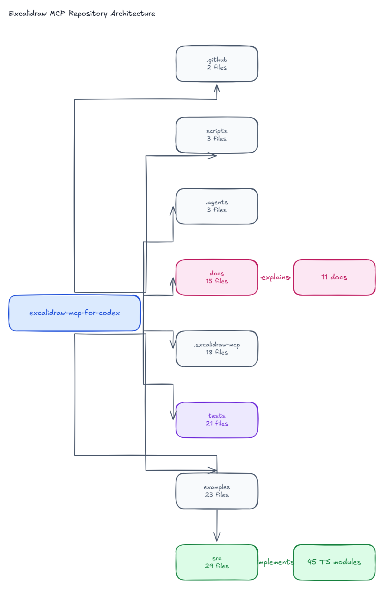
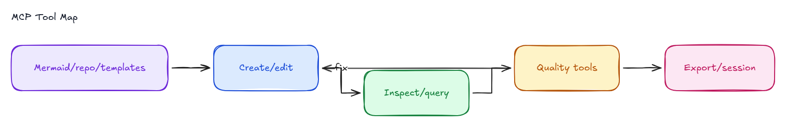
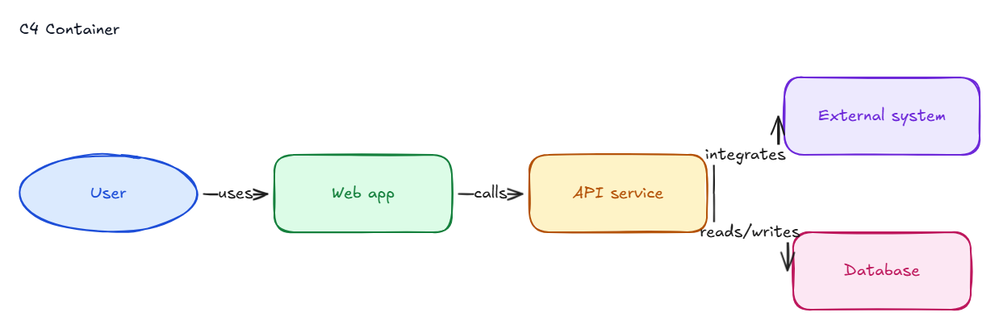
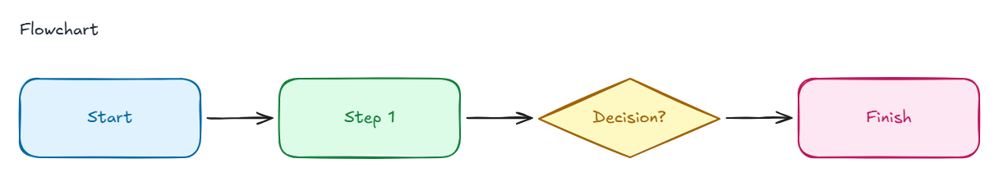
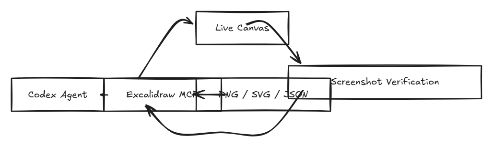
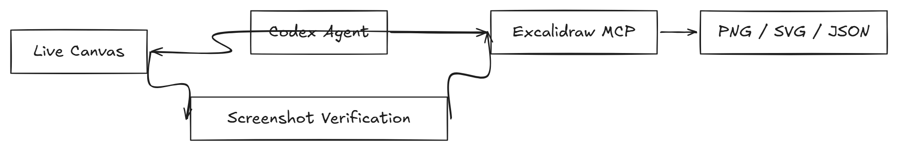
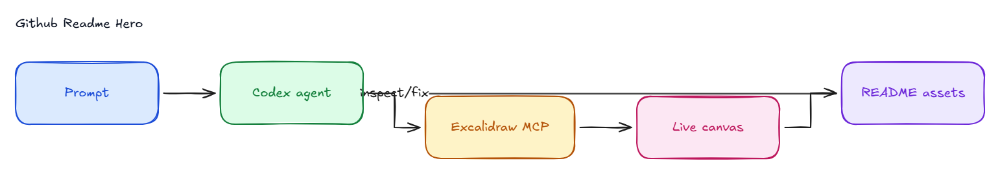

# Excalidraw MCP Example Gallery

Generated with `npm run examples:generate` after `npm run build`.

### Repository Architecture

- Scene: [repo-architecture.excalidraw](./repo-architecture.excalidraw)
- SVG: [repo-architecture.svg](./repo-architecture.svg)

### MCP Tool Map

- Scene: [mcp-tool-map.excalidraw](./mcp-tool-map.excalidraw)
- SVG: [mcp-tool-map.svg](./mcp-tool-map.svg)

### C4 Container Diagram

- Scene: [c4-container.excalidraw](./c4-container.excalidraw)
- SVG: [c4-container.svg](./c4-container.svg)

### Three Box Flowchart

- Scene: [flowchart.excalidraw](./flowchart.excalidraw)
- SVG: [flowchart.svg](./flowchart.svg)

### Mermaid Conversion Before Normalize

- Scene: [mermaid-before.excalidraw](./mermaid-before.excalidraw)
- SVG: [mermaid-before.svg](./mermaid-before.svg)

### Mermaid Conversion After Normalize

- Scene: [mermaid-after.excalidraw](./mermaid-after.excalidraw)
- SVG: [mermaid-after.svg](./mermaid-after.svg)

### README Hero Diagram

- Scene: [readme-hero.excalidraw](./readme-hero.excalidraw)
- SVG: [readme-hero.svg](./readme-hero.svg)
